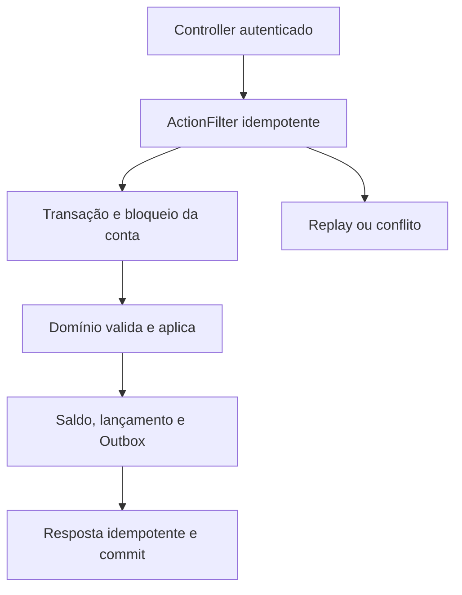
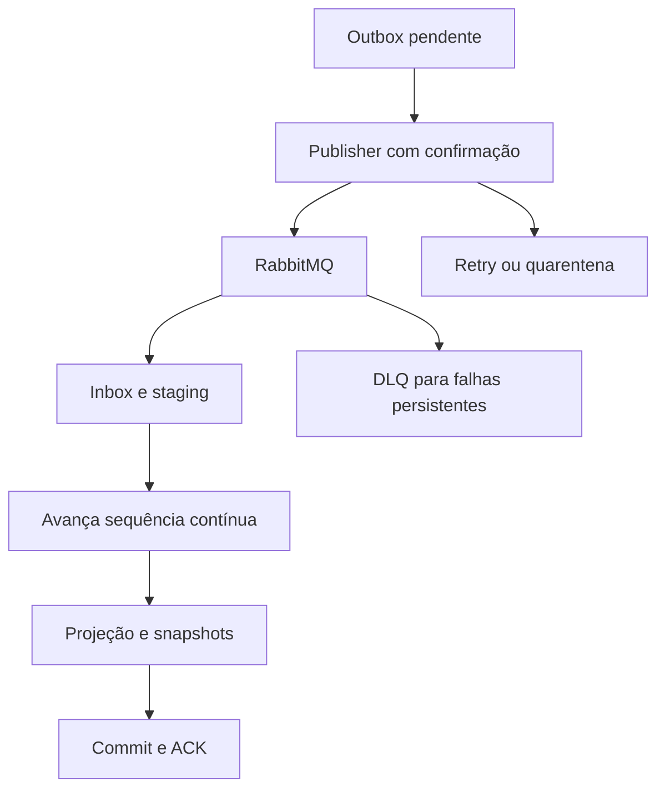
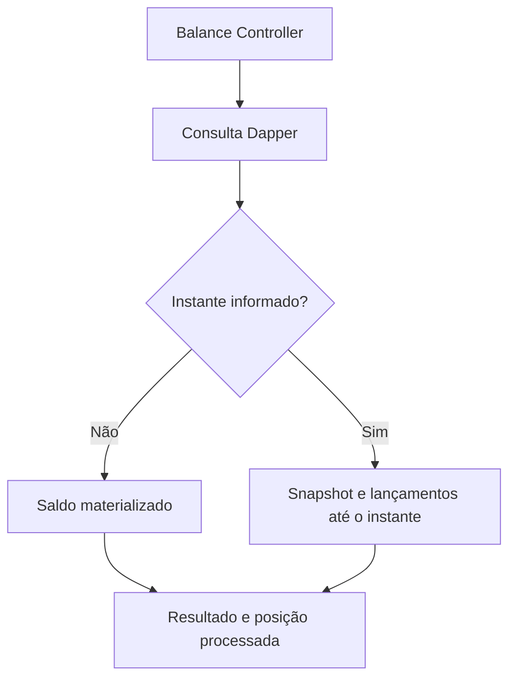

# Arquitetura

Monólito modular em dois bounded contexts, implantado em três processos. Ledger é a fonte de verdade; Balance mantém projeções. Dependências: Domain <- Application <- Infrastructure; cada Api/Worker compõe suas dependências. Contratos de integração são separados do transporte RabbitMQ.

## Escrita e recuperação

## Integração

## Leitura

Débitos nunca consultam o saldo eventual. A consolidação entre contas usa uma transação Repeatable Read no contexto Balance, mas não representa uma barreira de processamento global entre contas. Convergência exige recuperar eventos faltantes/quarentenados.

O worker usa polling limitado para simplificar a demonstração; consumidores push com prefetch e conexões separadas são evolução possível após medições. HTTP e AMQP podem confirmar antes de uma falha do processo; as chaves financeiras e inbox tornam retries seguros dentro das janelas documentadas.
